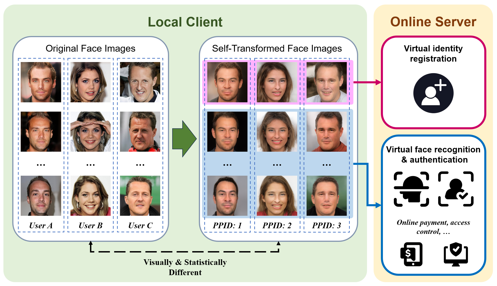
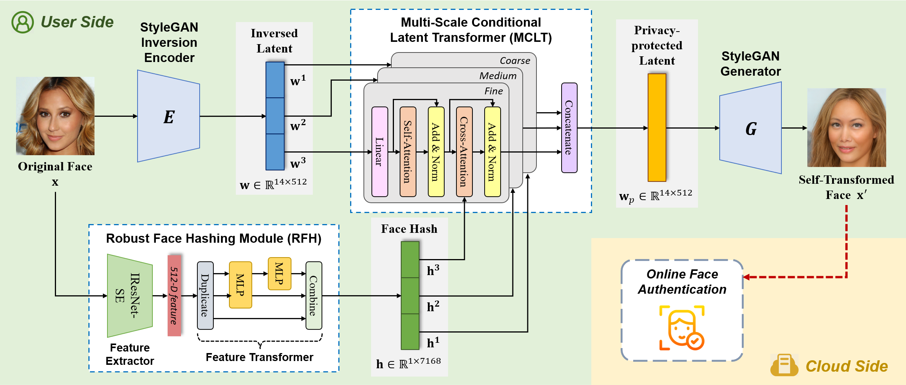
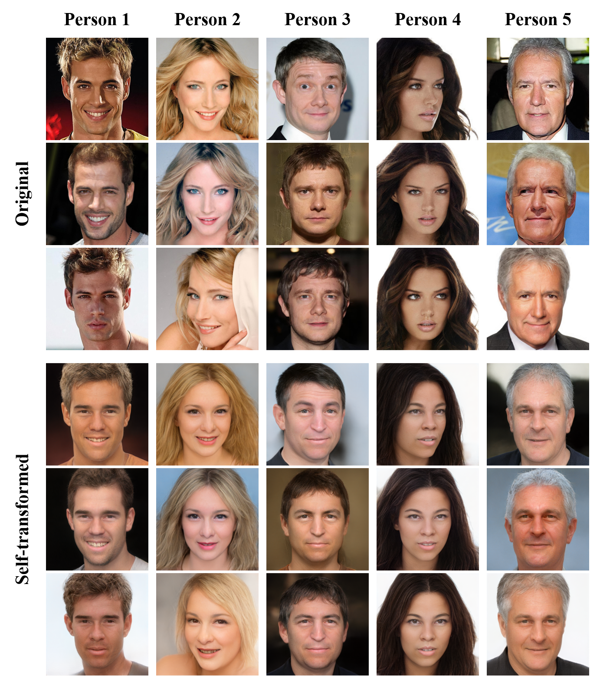

<div align="center">

# Identifiable Face to Face for Privacy Protection

Official PyTorch implementation of the paper published in **IEEE Transactions on Information Forensics and Security (TIFS), 2026**.

Xianhan Zeng · Sheng Li · Zhenxing Qian · Xinpeng Zhang · Jian Liu

[](https://ieeexplore.ieee.org/document/11711212)
[](LICENSE)

</div>

## Overview

Identifiable Face to Face (IF2F) transforms an original face into a visually and statistically different self-transformed face. Unlike key-based face protection methods, IF2F derives its transformation condition from the original face itself. Faces from the same person retain a consistent privacy-protected identity that can be used for authentication, while their identity is separated from the original face.

<p align="center">
  
  <br>
  <em>Faces are transformed locally; the server receives self-transformed faces for registration and authentication in the privacy-protected identity (PPID) space.</em>
</p>

IF2F combines four main components:

- a pretrained e4e encoder that maps an aligned face into the StyleGAN latent space,
- a Robust Face Hashing (RFH) module that extracts a stable face-dependent condition,
- a Multi-scale Conditional Latent Transformer (MCLT) that produces the self-transformed latent code,
- a pretrained StyleGAN2 generator that renders the anonymized face.

The training objective combines anonymity, contrastive identity consistency, perceptual quality, and face-structure preservation losses. IF2F is an anonymization method and does **NOT** provide face recovery.

<p align="center">
  
  <br>
  <em>IF2F architecture: RFH derives a condition from the input face, MCLT transforms its inverted latent, and StyleGAN generates the self-transformed face.</em>
</p>

## Self-transformed face examples

The examples below are from the paper and illustrate how different face images of the same person are transformed into a consistent privacy-protected identity, without a user-specific key or an external identity condition.

<p align="center">
  
  <br>
  <em>Each column represents one person. The top three rows show original faces; the bottom three show their corresponding self-transformed faces, illustrating identity consistency across different inputs.</em>
</p>

Please refer to the [paper on IEEE Xplore](https://ieeexplore.ieee.org/document/11711212) for quantitative results and their dataset, face-recognizer, and conditioning settings, as well as ablation studies and security analysis.

## Repository scope

This public release focuses on the practical core of the project:

- training the main IF2F configuration on identity-classified CelebA-HQ images,
- inference from one image or a directory of images,
- recursive directory processing with relative paths preserved,
- original/anonymized identity cosine similarity for each generated pair.

The complete research archive also contains ablation studies, security experiments, additional recognition backbones, and the full paper evaluation suite.
Please refer to the paper for the complete evaluation protocol and comparisons.

## Installation

The released checkpoint was verified on Linux x86-64 with Python 3.7.11, PyTorch 1.13.1, TorchVision 0.14.1, and CUDA 11.7.

Create the base environment:

```bash
conda env create -f environment.yml
conda activate if2f
```

Install the tested CUDA build of PyTorch and the remaining dependencies:

```bash
python -m pip install \
  torch==1.13.1+cu117 torchvision==0.14.1+cu117 \
  --extra-index-url https://download.pytorch.org/whl/cu117

python -m pip install -r requirements.txt --prefer-binary
python -m pip check
```

The PyTorch wheel must match the operating system, accelerator, and installed GPU driver. Replace the CUDA 11.7 command with an appropriate command from the official PyTorch installation guide when necessary.

Modern Conda releases use the faster libmamba solver. If dependency resolution is unexpectedly slow, update the base Conda installation or create the environment with a recent Miniconda or Miniforge distribution.

## Pretrained models

Download the released checkpoint package from either mirror:

- [Google Drive](https://drive.google.com/drive/folders/1bWWwn1a26YbUeU_DMuhlnD-KLcd4nQ9p?usp=sharing)
- [Baidu NetDisk](https://pan.baidu.com/s/1G05whYX4Zyw2FXPsoP9cvw) (extraction code: `kh14`)

Place the files in `pretrained_models/` as follows:

```text
pretrained_models/
├── best_iter212000.pt
├── e4e_ffhq_encode_256.pt
├── model_ir_se50.pth
├── parsenet.pth
└── stylegan2-ffhq-256.pt
```

### Checkpoint provenance

Only `best_iter212000.pt` is the released IF2F checkpoint. The remaining files are third-party pretrained models used by IF2F. Their original projects and download locations are listed below so that users can obtain them from, and review the terms of, the upstream sources.

| File expected by IF2F | Purpose | Required for | Original project and download |
|:--|:--|:--|:--|
| `best_iter212000.pt` | Released IF2F mapper and RFH checkpoint | Inference | IF2F release mirrors above |
| `e4e_ffhq_encode_256.pt` | e4e inversion encoder used at 256 px | Training and inference | [encoder4editing](https://github.com/omertov/encoder4editing) · [official FFHQ checkpoint](https://drive.google.com/file/d/1cUv_reLE6k3604or78EranS7XzuVMWeO/view?usp=sharing) |
| `stylegan2-ffhq-256.pt` | StyleGAN2 generator trained on FFHQ at 256 px | Training and inference | [rosinality/stylegan2-pytorch](https://github.com/rosinality/stylegan2-pytorch) · [official 550k checkpoint](https://drive.google.com/file/d/1PQutd-JboOCOZqmd95XWxWrO8gGEvRcO/view) |
| `model_ir_se50.pth` | IR-SE50 face-recognition backbone | Training, inference, and cosine similarity | [TreB1eN/InsightFace_Pytorch](https://github.com/TreB1eN/InsightFace_Pytorch#2-pretrained-models--performance) |
| `parsenet.pth` | Face parsing network | Training only | [CelebAMask-HQ face parsing](https://github.com/switchablenorms/CelebAMask-HQ/tree/master/face_parsing) · [official `model.pth`](https://drive.google.com/file/d/1o1m-eT38zNCIFldcRaoWcLvvBtY8S4W3/view) |

The release filenames are retained because they are the defaults used by the training and inference scripts. The upstream StyleGAN2 file may be named `550000.pt`, and the upstream CelebAMask-HQ file is named `model.pth`; rename them to the filenames shown above when downloading directly. The public e4e project distributes `e4e_ffhq_encode.pt`, whereas IF2F uses the 256-pixel variant listed above. Do not replace the IF2F file with the upstream checkpoint unless its 256-pixel, 14-code compatibility has been verified.

The ParseNet model was also used through [HairCLIP](https://github.com/wtybest/HairCLIP), but the table cites CelebAMask-HQ as the original face-parsing implementation and model source.

For integrity checking, the expected release files are:

| File | Size | SHA-256 |
|:--|--:|:--|
| `best_iter212000.pt` | 333.9 MiB | `5f721095a46cc3099b2705acb5ec5e4568b8ec8a5efe77c8d6ade4e69af2813f` |
| `e4e_ffhq_encode_256.pt` | 914.6 MiB | `8588a4e4e8239526329c0905536354cb8c18e1e97956a6f231bac87551587440` |
| `stylegan2-ffhq-256.pt` | 788.7 MiB | `70a891acc3c82280c9a8d132b62e4672e2273d14b692a0df5cb0e416de433c1b` |
| `model_ir_se50.pth` | 167.2 MiB | `a035c768259b98ab1ce0e646312f48b9e1e218197a0f80ac6765e88f8b6ddf28` |
| `parsenet.pth` | 7.5 MiB | `7914f1dccb37ab2f307703f2593efd74cc327d9db974424dff8d7510b46d85b5` |

Model weights are not stored in the source repository. See [pretrained_models/README.md](pretrained_models/README.md) for the same layout and download information.

Check the installation after the weights have been prepared:

```bash
python tools/check_environment.py --mode inference
python tools/check_environment.py --mode training
```

The LPIPS training loss uses pretrained VGG and LPIPS weights. On first use, TorchVision and PyTorch Hub download those files into the local PyTorch cache.

## Quick inference

Run IF2F on one aligned face image:

```bash
python inference.py \
  --input /path/to/face.png \
  --output_dir ./outputs
```

The same command accepts a directory and scans it recursively:

```bash
python inference.py \
  --input /path/to/images \
  --output_dir ./outputs \
  --batch_size 8
```

Results are written to:

```text
outputs/
├── original/
├── anonymized/
└── cosine_similarity.csv
```

Subdirectory structure below the input directory is preserved. Both image directories contain the resized 256 x 256 tensors actually used by the model.

`cosine_similarity.csv` reports IR-SE50 cosine similarity between each processed original image and its anonymized output. Lower similarity generally indicates greater identity separation, but this value is not a threshold-calibrated anonymity rate and should not be interpreted as the complete paper evaluation protocol.

Run `python inference.py --help` to view model-path, device, batch-size, and worker options.

## Dataset preparation

Training expects aligned CelebA-HQ images grouped by identity:

```text
/path/to/CelebA-HQ/
└── CelebA-HQ_classified/
    ├── 00001/
    │   ├── image_a.jpg
    │   └── image_b.jpg
    ├── 00002/
    │   └── ...
    └── ...
```

The dataset and its license are not included. After preparing the identity folders, generate the metadata used by training:

```bash
python tools/prepare_celeba_hq.py \
  --data_root /path/to/CelebA-HQ
```

This creates:

```text
pairs_celeba-hq_train.txt
triples_celeba-hq_val_nolabel.txt
```

Only identities containing at least two supported images are included. Existing metadata is not overwritten unless `--overwrite` is passed.

## Training

The shell script contains the released one-stage training configuration:

```bash
IF2F_DATA_ROOT=/path/to/CelebA-HQ \
IF2F_EXP_DIR=./experiments/if2f \
bash scripts/train.sh
```

Alternatively, invoke the Python entry point directly:

```bash
python train.py \
  --data_root /path/to/CelebA-HQ \
  --exp_dir ./experiments/if2f
```

The defaults reproduce the released configuration: a one-block MCLT with latent splits `4 4 6`, identity margin `0.01`, anonymity weight `0.5`, contrastive weight `0.1`, LPIPS weight `1.0`, parsing weight `0.1`, batch size `6`, and learning rate `0.0002`.

Checkpoints, TensorBoard logs, generated samples, and the effective options are saved below the experiment directory. Resume a run with:

```bash
python train.py \
  --data_root /path/to/CelebA-HQ \
  --exp_dir ./experiments/if2f \
  --resume ./experiments/if2f/checkpoints/iteration_10000.pt
```

## Project structure

```text
IF2F/
├── assets/                    # README figures
├── criteria/                  # Identity, LPIPS, and parsing losses
├── datasets/                  # CelebA-HQ pair and triplet readers
├── models/                    # e4e, RFH, MCLT, StyleGAN2, and backbones
├── pretrained_models/         # User-provided model weights
├── scripts/train.sh           # Released training command
├── tools/
│   ├── check_environment.py
│   └── prepare_celeba_hq.py
├── inference.py               # Single-image and recursive-folder inference
├── train.py                   # Main training entry point
├── environment.yml
└── requirements.txt
```

## Limitations and responsible use

- IF2F is designed for aligned face images and resizes inputs to 256 x 256. It does not include face detection or alignment.
- Cosine similarity from the inference script is a lightweight diagnostic, not a substitute for evaluation under a deployment-specific recognition system or threat model.
- Performance may vary across image quality, pose, occlusion, capture conditions, and demographic groups.
- Face privacy and biometric authentication are security-sensitive. Use authorized data, obtain appropriate consent, and comply with dataset licenses, privacy rights, and applicable law.
- Do not use this project for impersonation, surveillance abuse, or bypassing access controls.

## Citation

If this work is useful in your research, please cite:

```bibtex
@article{zeng2026if2f,
  title   = {Identifiable Face to Face for Privacy Protection},
  author  = {Zeng, Xianhan and Li, Sheng and Qian, Zhenxing and Zhang, Xinpeng and Liu, Jian},
  journal = {IEEE Transactions on Information Forensics and Security},
  year    = {2026},
  doi     = {10.1109/TIFS.2026.3737713}
}
```

## License

The IF2F-owned source code is released under the [MIT License](LICENSE). This license does not relicense third-party source code, pretrained models, or datasets. The convenience mirrors do not change the ownership or terms of the third-party checkpoints; users remain responsible for reviewing and complying with the corresponding upstream licenses and terms of use.

In particular, CelebAMask-HQ restricts its dataset to non-commercial research and its released software to non-commercial research and educational use. Refer to the [CelebAMask-HQ license and dataset agreement](https://github.com/switchablenorms/CelebAMask-HQ#license-and-citation) before using `parsenet.pth`. Face-recognition models and face datasets may carry additional research-only or data-dependent restrictions even when their implementation repositories use a permissive software license.

## Acknowledgments

This implementation builds on [StyleGAN2](https://github.com/rosinality/stylegan2-pytorch), [e4e](https://github.com/omertov/encoder4editing), [InsightFace_Pytorch](https://github.com/TreB1eN/InsightFace_Pytorch), [CelebAMask-HQ](https://github.com/switchablenorms/CelebAMask-HQ), and [RiDDLE](https://github.com/DongzeLi-CASIA/RiDDLE). We thank their authors and contributors.
